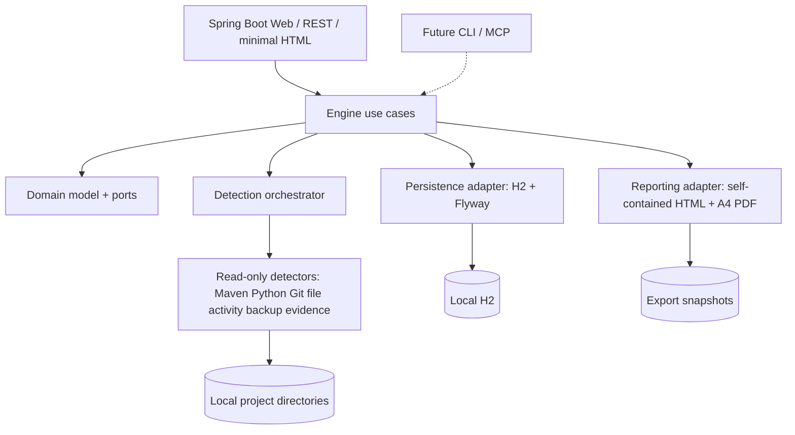

# Architecture — modular monolith / ports & adapters

## Maven modules

- `kodvido-domain`: immutable domain objects, interfaces for catalog, detection, reporting, clock, and status conventions. No Spring.
- `kodvido-detection`: read-only scanners; file tree walking, language/build recognition, detector diagnostics. No H2/UI dependency.
- `kodvido-engine`: discovery/import/relocation/decision use cases; interfaces first; ideally Spring-free.
- `kodvido-persistence`: H2/Flyway and repository implementations; never holds canonical user project markdown.
- `kodvido-reporting`: snapshot DTO and pure rendering; export offline HTML and PDF. A4 layout separate from live UI.
- `kodvido-app`: composition root, Spring Boot, REST controllers, server-rendered UI; no business rules in controllers.

## Detection contract / future capabilities

Every detector: stable ID, applicability, time/effort limit, version, observations + diagnostics, `SUPPORTED/PARTIAL/UNSUPPORTED/FAILED` outcome, no write operations. Evidence includes origin and timestamp. Provide a sanitized enhancement request for partial/unsupported cases.

## Security and paths

- Launch server on loopback; if state-changing endpoints are later exposed, protect against CSRF and malicious local pages.
- Do not resolve/traverse symlinks or NTFS junctions by default. Ignore vendor/build dirs. Respect cancellation, timeouts, permissions and traversal limits.
- Scan reports must escape HTML to prevent file names becoming XSS. Report CSS/JS must be embedded for offline viewing.
- Stable UUID is independent from path; relocating updates only path mapping.
- No automatically running arbitrary `*.bat` / `*.sh` discovered during scan. Future actions need opt-in.

## Storage

H2 file-backed data for catalog, locations, scan runs, observation metadata, user interactions and configuration. Project docs stay in the actual project directory. Cache is disposable/rebuildable; catalogue must be independently exportable in a portable format. Keep multiple local profiles/instances physically separate.

## Decisions / ADR candidates

Use Spring Data JDBC rather than JPA if CRUD straightforward; use Flyway for schema evolution. For A4 PDF, compare Java-only OpenHTMLtoPDF vs headless-browser export and select the most reproducible cross-platform path with image snapshot tests.
