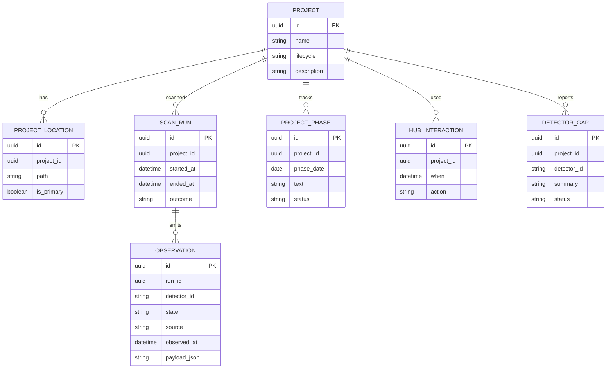

# Initial logical data model (not yet all implemented)

Do not create a large ORM model before M1. Enforce UUID identifiers independent of filesystem location. Phases may reside in PROJECT.md instead of database when detected as project-owned documentation; resolve source-of-truth and precedence with ADR before implementation.
